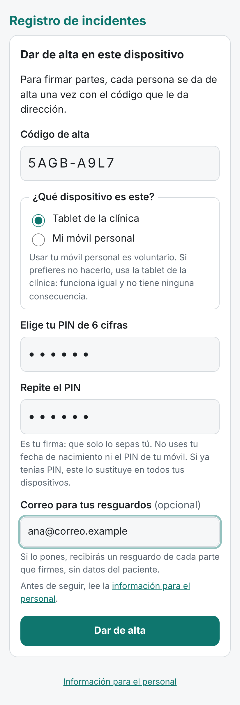
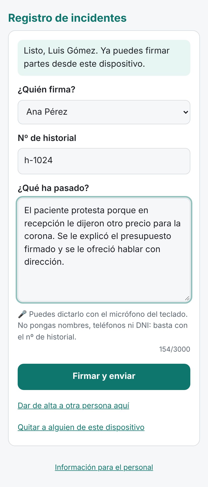
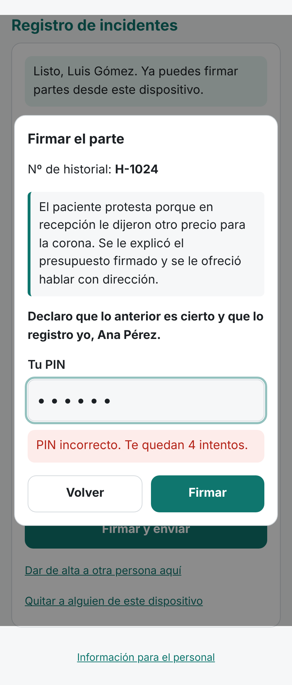
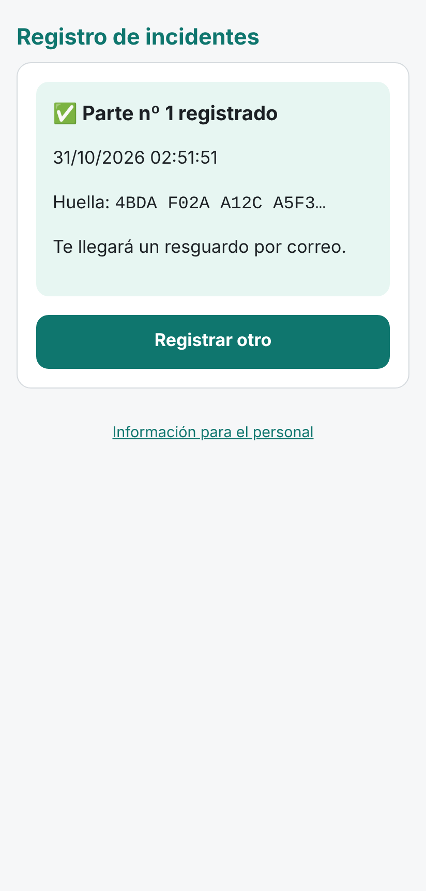

# Registro de incidentes firmado

Un registro sencillo para que el personal de una clínica pequeña deje constancia de los **incidentes con pacientes**, como un paciente que se enfada por un precio o una corona que se rompe y genera una protesta. Cada parte queda **firmado por quien lo escribe** y dirección lo ve al momento.

| Alta en la tablet | Registrar | Firmar | Registrado |
|---|---|---|---|
|  |  |  |  |

*(Capturas con datos ficticios.)*

## Cómo funciona

1. En la tablet de recepción, la persona elige su nombre, escribe el nº de historial y cuenta qué pasó. Puede dictarlo con el micrófono del teclado.
2. Pulsa **Firmar y enviar**, lee la declaración (*«Declaro que lo anterior es cierto y que lo registro yo»*) y pone su PIN de 6 cifras.
3. El parte llega a una hoja de Google que **solo ve dirección**, con número, fecha y huella. Dirección recibe un aviso por correo y, si quiere, por Google Chat en el móvil. El aviso **no lleva datos del paciente**. Si la persona dejó su correo, recibe un resguardo.

## Por qué lo registrado es difícil de discutir

- **Firma del dispositivo + PIN.** Al darse de alta, el dispositivo genera una clave de firma que no se puede copiar, ni siquiera desde la propia página. Cada parte va firmado con esa clave y validado con el PIN personal.
- **Cadena de huellas.** Cada parte incluye la huella del anterior. Si se cambia o se borra uno, la cadena se rompe.
- **Ancla diaria.** Cada noche se envía por correo la última huella, también a alguien de fuera (por ejemplo, el delegado de protección de datos). Así nadie puede reescribir el pasado sin que se note.
- **Resguardo para el empleado.** Le llega con el número y la huella de cada parte que firma. Si alguien firmara en su nombre, lo vería.
- **Nada se edita.** Una corrección es un parte nuevo.
- **Verificador independiente.** [`verificar.html`](verificar.html) comprueba en el navegador las firmas, las huellas y las anclas. Si dirección reescribiera un parte y recalculara todas las huellas, la firma del dispositivo lo delataría (hay una prueba automática para esto).

Qué garantiza y qué no: [documentacion/seguridad-y-limites.md](documentacion/seguridad-y-limites.md).

## Qué no es

- **No es el sistema de reclamaciones formales.** Las reclamaciones siguen con la hoja oficial de reclamaciones y no hace falta anotarlas aquí.
- **No usa biometría:** ni huella, ni cara, ni firma manuscrita.
- **No obliga a usar el móvil personal.** La vía normal es una tablet de la clínica; el móvil propio es voluntario.
- **No guarda nada en los dispositivos** salvo quién está dado de alta y su clave de firma.
- **No es asesoramiento legal ni un producto sanitario.** Antes de usarlo con datos reales, revísalo con tu delegado de protección de datos: [documentacion/lista-para-el-dpd.md](documentacion/lista-para-el-dpd.md).

## Piezas

| Ruta | Qué es |
|---|---|
| `index.html`, `app/` | Página del personal (se publica con GitHub Pages; no guarda datos) |
| `apps-script/` | Backend: se pega en el Apps Script de la hoja de dirección |
| `verificar.html` | Verificador de firmas y huellas para dirección |
| `informacion.html` | Información para el personal (plantilla para completar) |
| `documentacion/` | Instalación, uso diario, seguridad, lista para el DPD y plantillas |
| `tests/` | Pruebas automáticas |

## Puesta en marcha

En resumen: creas la hoja en tu Google Workspace, pegas el código, lo publicas como aplicación web, pones su dirección en `config.js` y activas GitHub Pages. Paso a paso en [documentacion/instalacion.md](documentacion/instalacion.md). El uso del día a día está en [documentacion/uso-diario.md](documentacion/uso-diario.md).

El repositorio puede ser público: no contiene datos ni claves. **No subas nunca exportaciones de la hoja ni datos reales.**

## Pruebas

```sh
npm test       # backend real (Codigo.gs) en un simulador de Apps Script, con la criptografía real de la página
npm run e2e    # la página en Chromium de punta a punta (necesita Playwright)
```

## Licencia

[Apache-2.0](LICENSE). Si lo mejoras, compártelo.
